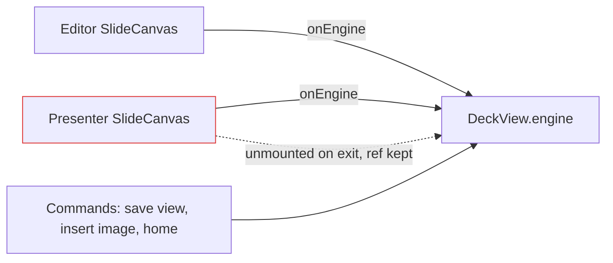

# Review of canvas-deck (src/, 17 files, ~1,500 lines)

Rules loaded: universal/code-standards, universal/resource-release, web/state, universal/naming-and-comments.
Run mode: fresh.

## Orientation
Stack: TypeScript, React 19 + Excalidraw 0.18.1, Obsidian plugin. Entry: src/main.ts (esbuild → main.js).
Layout: src/{canvas,deck,present,obsidian,dev}; tests/ (vitest) and tests/e2e (Playwright); dev/harness.
Churn: young repo (5 commits). Hot: SlideCanvas.tsx, README.md, Presenter.tsx, main.ts.
Hot intersection (large × high-churn): none; repo too new for a signal.
Mental model: `canvas/` wraps one Excalidraw scene per slide behind CanvasEngine (camera, images, motion picture). `deck/` holds the deck model, the markdown format and the editor UI. `present/` is the fullscreen player. `obsidian/` and `main.ts` adapt to the vault. Matches the README.

Findings: 11 total (0 critical, 2 high, 2 medium, 7 low)

## Severity × Category
|                     | Critical | High | Medium | Low |
|---------------------|----------|------|--------|-----|
| State / correctness | 0        | 2    | 2      | 1   |
| Resource release    | 0        | 0    | 0      | 1   |
| Dead code           | 0        | 0    | 0      | 2   |
| Missing pattern     | 0        | 0    | 0      | 1   |
| Naming / hygiene    | 0        | 0    | 0      | 1   |
| Feature gap         | 0        | 0    | 0      | 1   |

## Diagram
F002: which canvas the Obsidian commands talk to.

## Per-file findings

### src/deck/deck-view.tsx (127 lines)
- F001 [High/S] State — L45-49, L55-57. If the note fails to parse (bad JSON edited by hand, or another file opened in the same tab), `this.deck` keeps the old deck. The next save writes that old deck over the file and the hand edit is lost. Fix: on parse error set `this.deck = null` and unmount, so `getViewData()` returns the raw text; reset `this.deck` in `clear()`. Rule: web-derived-state-preferred.
- F009 [Low/S] Hygiene — L3-5, L22-24. Two imports from `../canvas/vault-images`; empty constructor.

### src/deck/DeckEditor.tsx (249 lines)
- F002 [High/S] State — L153-160. After Present exits, `DeckView.engine` still points to the presenter's unmounted canvas. "Save current view" is then silently lost (presenter's onChange is a no-op); "Insert vault image" and "Go to start frame" act on a dead canvas. Fix: on exit, send the editor's engine again. Rule: web-derived-state-preferred.
- F003 [Medium/S] State — L46, L61-68. Add or Duplicate on the last slide does not select the new slide: `select` clamps with the old slide count. Fix: `setCurrent(current + 1)` for these two.
- F006 [Low/S] State — L158 with Presenter.tsx:46-57. `onExit` is a new function every render; the fullscreen effect depends on it, so any parent re-render exits and re-enters fullscreen. Latent today. Fix: `useCallback`.
- F011 [Low/M] Feature gap — L233-236. Thumbnails pass `files: null`, so images never show in the slide list.

### src/canvas/motion-snapshot.ts (72 lines)
- F004 [Medium/S] State — L46-47, L66-70. If `prepare()` finishes during an animation it swaps `snap`; `end()` then removes the new canvas and the old picture stays stuck over the live canvas. Fix: remember the attached canvas and remove that one.

### src/canvas/engine.ts (146 lines)
- F005 [Low/S] Resource release — L47-51. The prepare timer is never cleared when the canvas unmounts; it later renders a dead scene. Fix: `dispose()` that clears it, called from SlideCanvas unmount. Rule: scoped-release-idiom.
- F007 [Low/S] Dead code — L111-114. `CanvasEngine.renameImage` has no caller (DeckView renames on the deck instead).
- F010 [Low/S] DRY — L144-146 vs deck-model.ts:17-19. Two random-id helpers. Use `newId` in both.

### Test-only exports
- F008 [Low/S] Dead code — deck-format.ts:10 `isDeckText`, slide-data.ts:44-50 `styleOf`/`roughnessFor`, stepper.ts:23 `isEnd`, camera.ts:162 `setReadOnly`, SlideCanvas.tsx:10 `readOnly` prop. Only tests use them. Keep `styleOf`/`roughnessFor` if the sketch/clean toggle is still planned.

### No findings
src/main.ts, src/present/stepper.ts (besides F008), src/present/Presenter.tsx (besides F006), src/canvas/camera.ts, src/canvas/SlideCanvas.tsx, src/canvas/slide-data.ts, src/canvas/vault-images.ts, src/deck/deck-format.ts, src/deck/deck-model.ts, src/obsidian/vault-image-store.ts, src/deck/deck.css.

## Findings table
| ID   | Category | File:Line | Sev | Effort | Description | Recommendation |
|------|----------|-----------|-----|--------|-------------|----------------|
| F001 | State | src/deck/deck-view.tsx:47 | High | S | Parse error keeps old deck; save overwrites file | Null deck + unmount on error; reset in clear() |
| F002 | State | src/deck/DeckEditor.tsx:158 | High | S | Commands use dead presenter canvas after exit | Re-send editor engine on exit |
| F003 | State | src/deck/DeckEditor.tsx:46 | Medium | S | New last slide not selected | setCurrent(current + 1) |
| F004 | State | src/canvas/motion-snapshot.ts:47 | Medium | S | Stale picture can stick on screen | Track attached canvas |
| F005 | Resource | src/canvas/engine.ts:50 | Low | S | Timer outlives canvas | dispose() on unmount |
| F006 | State | src/present/Presenter.tsx:57 | Low | S | Fullscreen effect re-runs on re-render | useCallback onExit |
| F007 | Dead code | src/canvas/engine.ts:111 | Low | S | Unused method | Delete |
| F008 | Dead code | several | Low | S | Test-only exports | Delete or keep for planned features |
| F009 | Hygiene | src/deck/deck-view.tsx:3 | Low | S | Split import, empty constructor | Merge, delete |
| F010 | DRY | src/canvas/engine.ts:144 | Low | S | Two id helpers | Reuse newId |
| F011 | Feature gap | src/deck/DeckEditor.tsx:235 | Low | M | No images in thumbnails | Load files for thumbs |

## Quick wins (Low effort × Medium+ severity)
- [ ] F001, F002, F003, F004

## Things that look bad but are actually fine
- src/main.ts:6 imports `src/dev/demo-deck` into the shipped plugin. Intended: "New demo deck" is a user command.
- src/canvas/camera.ts:103-145 `goToBounds` is ~40 lines of nested closures. It is one cancel/settle flow; splitting would scatter the token checks.
- src/deck/deck-format.ts:8 the block regex looks Windows-unsafe. It isn't: with the `m` flag `$` matches before `\r`, and JSON.parse allows trailing `\r`.
