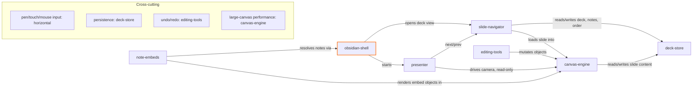

# Vision — canvas-deck (v1)

## Elevator pitch
An Obsidian plugin for making and presenting slide decks where every slide is its own infinite canvas. You draw, write and move things freely, keep speaker notes per slide, and in present mode you step through slides while still panning and zooming around a huge diagram inside one slide. For one person who thinks visually and lives in Obsidian. Success: a deck with a big diagram slide can be built and presented end to end without leaving Obsidian, on desktop and with a pen on iPad.

## UX walkthrough
Surfaces: Obsidian desktop and Obsidian mobile (iPad/phone), as a custom view inside the app plus a fullscreen present mode.

Main flow: the user runs "New deck" and gets a deck file in the vault. The deck view opens with a slide list on the side and the current slide as an infinite canvas. They draw with mouse or pen, type text, add shapes, select and move or resize things, and drop in links or embeds of vault notes. They add, reorder and delete slides from the list and type speaker notes under each slide. Saving is automatic to the deck file.

Present flow: the user starts present mode. Each slide opens at its saved starting view. Arrow keys, clicks or swipes go to the next or previous slide. Inside a slide they can pan and zoom freely to walk through a large diagram, then return to the starting view or move on. Speaker notes show in a separate presenter panel when a second screen is available.

## Module map

## Modules
### obsidian-shell
- **Role:** Plugin entry point; registers the deck view, file type, commands and settings with Obsidian.
- **Owns:** plugin lifecycle, commands, settings, file-type registration, vault API access
- **Depends on:** nothing — entry point
- **Does not do:** drawing, saving deck content, presenting

### deck-store
- **Role:** Reads and writes deck files in the vault, including slides, order and speaker notes.
- **Owns:** deck file format, autosave, slide order, speaker notes storage, format versioning
- **Depends on:** obsidian-shell (vault access)
- **Does not do:** rendering, editing logic, Keynote/PPTX export

### canvas-engine
- **Role:** Renders one slide as an infinite canvas with pan, zoom and a camera.
- **Owns:** scene objects, rendering, camera/viewport, hit-testing, saved start view per slide
- **Depends on:** deck-store
- **Does not do:** tool UI, slide switching, file IO

### editing-tools
- **Role:** Tools the user creates and changes content with on a slide.
- **Owns:** pen/ink, text, shapes, select/move/resize, toolbar, undo/redo
- **Depends on:** canvas-engine
- **Does not do:** rendering, saving, presenting

### slide-navigator
- **Role:** Manages the list of slides and which one is active, in edit mode.
- **Owns:** slide list panel, add/reorder/delete slides, active slide, speaker notes editor
- **Depends on:** deck-store, canvas-engine
- **Does not do:** drawing, fullscreen presenting

### presenter
- **Role:** Fullscreen present mode with slide stepping and free pan/zoom inside a slide.
- **Owns:** present mode, transitions, next/prev controls, return-to-start view, presenter notes panel
- **Depends on:** slide-navigator, canvas-engine
- **Does not do:** editing, saving

### note-embeds
- **Role:** Puts Obsidian notes on a slide as links or live embeds.
- **Owns:** note link objects, note embed rendering, open-note-on-click
- **Depends on:** canvas-engine, obsidian-shell
- **Does not do:** editing notes, general canvas objects

## Cross-cutting concerns
- **Pen/touch/mouse input** — horizontal: every module uses pointer events with pressure support and has no hover-only controls, so desktop and mobile behave the same.
- **Persistence** — owned by deck-store
- **Undo/redo** — owned by editing-tools
- **Performance on big diagrams** — owned by canvas-engine
- **Error handling** — horizontal: never lose user content; failed saves or loads show an Obsidian notice and keep the in-memory state.

## Non-goals
- Live collaboration or multi-user editing; this is a single-user vault tool.
- Importing or exporting PowerPoint/Keynote files; decks live in the vault.
- Animation timelines or per-object build animations; only simple slide transitions.
- Being a general whiteboard replacing Obsidian Canvas or Excalidraw; it is a presentation tool first.

## Grounded context
None applicable. No stored rules or decisions exist for this project yet.

## Open questions
- Build canvas-engine on an existing library (Excalidraw, tldraw, Konva) or from scratch? Licence and mobile pen quality decide it.
- Deck file format: one JSON file, or markdown with embedded data so it stays readable in the vault?
- note-embeds is "leaning yes": confirm it is in the first version or move it later.
- Presenter notes panel on a second screen: does Obsidian's popout window cover this on desktop, and what happens on iPad?

## Next moves
Spec canvas-engine first, since the library choice shapes editing-tools, presenter and performance. Then deck-store, because the file format must be settled before anything saves. slide-navigator and presenter can follow together; note-embeds can wait until the core works.
